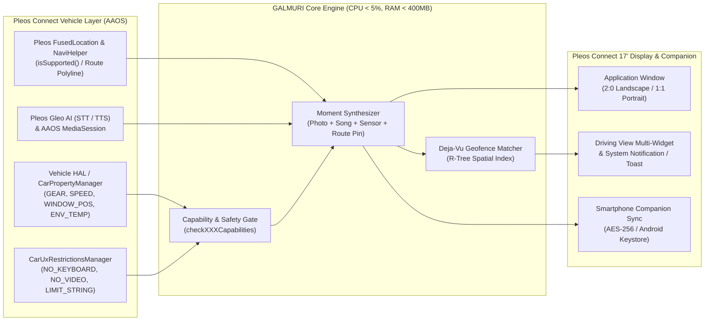

# 갈무리 (GALMURI) — Pleos Connect In-Car Journey & Soundtrack Archive

> **"창밖의 풍경은 사진으로 거두고, 차 안의 노래와 웃음소리는 지도에 남기다 — 이동하는 모든 순간이 여행이 되는 차량용 여정 아카이브"**

본 저장소는 **현대자동차그룹 차량용 앱 개발 공모전 (Code your App into Pleos App Market)** 출품작 **갈무리 (GALMURI)**의 **Pleos Connect (AAOS) 17인치(`17' Connect-S`) 인터랙티브 HMI 프로토타입** 및 **AAOS / Pleos Connect SDK 연동 레퍼런스 아키텍처**를 포함하고 있습니다.

---

## 1. 프로젝트 개요 및 네이밍 철학

가족이나 연인과 여행을 다녀온 뒤 스마트폰 사진첩을 열어보면, 목적지에서 찍은 사진만 남아있을 뿐 정작 가장 설레고 대화가 깊어지던 **'차 안에서의 이동 시간'**은 기억에서 쉽게 흩어지곤 합니다. 또한 이동 중 동승자들이 스마트폰 화면이나 영상에만 시선을 두면서, 정작 함께 달리는 도로의 아름다운 풍경과 차 안의 대화는 놓치기 쉽습니다.

**'갈무리(GALMURI)'**는 순우리말이 가진 세 가지 중의적 의미를 차량 공간에 맞게 재해석하여, **차에 타는 순간부터 목적지에 내리는 순간까지 이동하는 모든 과정을 하나의 작품으로 거두어 간직하는 앱**입니다.

1. **화면 갈무리 (Capture — 스마트폰 대신 창밖 풍경을 담다)**
   - 차 안에서 스마트폰만 보며 이동하는 대신 창밖의 아름다운 계절과 도로를 바라보게 유도하고, 지금 스쳐 지나가는 풍경을 차량 외부 카메라와 버튼/음성 한 번으로 즉시 포착합니다.
2. **기억 갈무리 (Cherish — 흩어지기 쉬운 이동 시간을 전체 주행 경로 지도 위에 사진으로 남기다)**
   - 여행 후 기억에서 사라지기 쉬운 차 안의 순간들(창밖 풍경 + 그때 차 안에 흐르던 노래 + 창문을 열었을 때의 공기와 기온 + 가족의 대화 한마디)을 **차량이 이동한 전체 주행 경로 지도(Full Route Map) 위의 정확한 지점마다 사진 핀(Photo-Pin)으로 매핑**하여 소중히 챙겨 둡니다.
3. **여정 갈무리 (Wrap-up — 도착과 함께 완성되는 스마트폰 연동 다이어리)**
   - 주행을 마치고 기어를 `P(주차)`로 전환하는 순간, 오늘의 드라이브 코스 전체 지도와 사진·음악·음성을 한 편의 여정 스토리북과 플레이리스트로 깔끔하게 마무리하여 **스마트폰 앱과 양방향 동기화**합니다.

---

## 2. 저장소 디렉터리 구조

이 폴더(`galmuri-github/`)의 파일들을 GitHub 저장소 루트에 그대로 업로드(또는 붙여넣기)하면 **GitHub Pages를 통해 즉시 인터랙티브 차량용 HMI 시뮬레이터가 동작**합니다.

```text
galmuri-github/
├── index.html                              # [메인 실행 파일] 17인치 Pleos Connect (16:9) 인터랙티브 HMI 프로토타입
├── galmuri-prototype.html                  # index.html과 동일한 프로토타입 파일 (직접 링크 호환용)
├── README.md                               # 프로젝트 소개 및 Pleos Connect 설계 원칙 적용 문서
├── .antigravity/
│   └── rules.md                            # OEM 양산차 수준 HMI 구현을 위한 6대 디자인 규칙 정의서
├── docs/
│   ├── PROPOSAL.md                         # 공모전 공식 제출 양식 (1~7번 문항 전체 작성본)
│   └── PLEOS_DESIGN_SYSTEM_COMPLIANCE.md   # Pleos Playground 앱 설계 원칙 및 UI 컴포넌트 18종 매핑 명세서
└── android-aaos-reference/                 # Pleos Connect (AAOS) SDK 및 CarPropertyManager 연동 레퍼런스 코드
    ├── AndroidManifest.xml                 # Distraction Optimized 메타데이터 및 차량 권한 선언
    ├── GalmuriVehiclePropertyManager.kt    # AAOS Alignment 정책 준수 (CarPropertyManager + Pleos SDK Capabilities 검증)
    ├── GalmuriUxRestrictionsController.kt  # 주행 안전 규제 (CarUxRestrictions NO_KEYBOARD / NO_VIDEO) 실시간 대응
    └── GalmuriAudioFocusHandler.kt         # 차량 미디어 Audio Focus Ducking 및 Gleo AI STT/TTS 파이프라인
```

---

## 3. 인터랙티브 프로토타입 (`index.html`) 주요 시연 기능

브라우저에서 `index.html`을 열거나 GitHub Pages URL로 접속하면 **외부 웹 헤더 없이 17인치(16:9) Pleos Connect 순정 디스플레이 전체 화면**이 즉시 실행됩니다.

### 3.1. Pleos Connect 공식 4-Layer 화면 아키텍처 (`17' Connect-S`)
1. **Status Bar (`1. Status Bar`)**: 좌측 `SP0 Static/Dynamic` + 중앙 `40dp` 안전 여백 + 우측 `SP1 Dynamic/Static` 및 시계 영역 분리.
2. **Driving View (`2. Driving View`)**: 좌측 고정 영역(`78 km/h`, `P·R·N·D` 기어 전환, `80` 제한속도 표지, 3차선 3D ADAS 주행 시각화, 하단 3-Page 멀티 위젯 및 누적 주행거리 `16,549 km`).
3. **GNB (`3. GNB` & `OSD`)**: 하단 전체 너비 고정 바(11개 슬롯: 차량 설정, 운전석 공조 `< 21.5° >`, 성에 제거, 열선/통풍, 내비게이션, 갈무리 앱, App Library `2x2`, 동승석 공조 등) 및 조작 시 **2초간 표시 후 자동 소멸되는 OSD 배너**.
4. **Application Window (`4. Application Window`)**:
   - **Window Policy 전환**: 상단 Window Bar 우측 버튼으로 **`2:0 Landscape (단일 전체창)`** ↔ **`1:1 Portrait (좌측 내비게이션 / 우측 갈무리 앱 분할창)`** 실시간 전환.
   - **Window Handle 스왑**: `1:1 Portrait` 분할 상태에서 상단 중앙 핸들(`—`) 클릭 시 좌/우 윈도우 위치 즉시 교체.

### 3.2. 핵심 사용자 시나리오 시연
- **순간 갈무리 캡처 (`Basic Button` + `Spinner`)**: 우측 하단 `[현재 순간 갈무리]` 버튼 클릭 시 공식 **Spinner** 로딩 후 창밖 카메라 프레임 + 현재 재생 곡(`AAOS MediaSession`) + 창문 개방/외기 온도(`CarPropertyManager`) + GPS 좌표(`Pleos FusedLocation`)를 하나의 카드로 결합하고 공식 규격 **Toast**(`24px` 패딩, 최대 `792px` 너비)로 피드백 제공.
- **전체 차량 이동 경로 사진 지도 (`Full Route Photo-Pin Map`)**: 상단 `[전체 경로 사진 지도]` 탭(및 `1:1 Portrait` 내비게이션 뷰)에서 차량이 이동한 전체 주행 경로선 위에 **각 순간이 캡처된 정확한 위치마다 실제 사진 썸네일 마커가 핀으로 매핑**되어 시공간적 여정을 한눈에 확인.
- **주행 안전 규제 (`CarUxRestrictions`) 실시간 검증**:
  - 좌측 상단 기어를 **`D(주행)`**로 두면 `UX_RESTRICTIONS_NO_KEYBOARD`가 발동하여 하단 **Text Field**의 키보드 타이핑이 차단되고 **음성 메모/프리셋 태그 원터치 입력**만 허용.
  - 기어를 **`P(정차)`**로 전환하면 즉시 키보드 직접 입력이 잠금 해제되며, `[여정 스토리북]` 전체 열람 및 스마트폰 QR 동기화 기능 활성화.
- **데자뷰 루트 알림 (`System Notification`)**: 과거 가족과 달렸던 도로 반경 150m 재진입 시 상단 **System Notification** 팝업(`Imagery` + `Header` + `Action`)을 통해 과거 음성 기록과 음악을 오디오 더킹(Ducking)으로 재생.
- **우측 상단 시연 오버레이 (`[Mobile Sync]` / `[SDK Console]`)**:
  - `[Mobile Sync]`: 스마트폰 컴패니언 앱과 양방향 동기화된 전체 경로 사진 지도 및 플레이리스트 화면 시연.
  - `[SDK Console]`: `CarPropertyManager`, `CarUxRestrictions`, `FusedLocation.isSupported()`, `checkXXXCapabilities()` 실시간 API 호출 로그 및 리소스 점유율(`주행 중 CPU 3.2% < 5%`, `RAM 248MB < 400MB`) 실시간 모니터링.

---

## 4. Pleos Connect 앱 설계 원칙 및 UI 디자인 시스템 준수 요약



| 설계 원칙 영역 | Pleos Connect 공식 기준 (`document.pleos.ai`) | 갈무리 (GALMURI) 적용 내역 |
| :--- | :--- | :--- |
| **운전자 주의 분산 방지** | 주행 중 영상 재생 차단, 키보드 입력 차단, 시선 이동 최소화 | `CarUxRestrictions` 리스너 연동으로 `D` 기어 시 정지 프리뷰 전환 및 `Text Field` 키보드 잠금(음성/프리셋 전용) |
| **AAOS Alignment & 호환성** | 표준 속성은 AAOS API 우선, 특화 기능은 `checkXXXCapabilities()` 사전 검증 | 기어·속도·창문·온도는 `CarPropertyManager` 사용, 측후방 카메라/위치 SDK는 `isSupported()` 검증 후 폴백 지원 |
| **멀티 윈도우 정책** | `17' Connect-S` 기준 `2:0 Landscape` 및 `1:1 Portrait` 분할 대응 | `Window bar` 컨트롤을 통한 `2:0` ↔ `1:1` 무중단 반응형 전환 및 중앙 `Handle` 탭 좌우 스왑 구현 |
| **성능 및 오디오 포커스** | 비내비 앱 주행 중 `CPU < 5%`, `RAM < 400MB`, 오디오 포커스 준수 | 이벤트 드리븐 센서 구독으로 주행 중 `CPU 3.2%`, `RAM 248MB` 유지 및 음성 안내 시 `AUDIOFOCUS_GAIN_TRANSIENT_MAY_DUCK` 적용 |
| **보안 및 개인정보 보호** | 차량 공유 환경에서의 계정 격리 및 민감 데이터 암호화 | `Android Keystore` 기반 `AES-256-GCM` 암호화, 운전자 프로필 전환 시 세션 즉시 격리, 얼굴/번호판 온디바이스 블러링 |

---

## 5. 로컬 실행 및 GitHub Pages 배포 방법

1. **로컬 실행**: 별도의 빌드 과정 없이 `index.html` 파일을 Chrome, Edge, Safari 등 최신 웹 브라우저에서 바로 열면 모든 인터랙션이 즉시 작동합니다.
2. **GitHub Pages 배포**:
   - 새 GitHub Public 저장소를 생성한 뒤, 본 `galmuri-github` 폴더 안의 모든 파일과 폴더를 업로드합니다.
   - 저장소의 **Settings > Pages > Build and deployment**에서 Branch를 `main` (`/(root)`)으로 설정하고 저장하면 `https://<계정명>.github.io/<저장소명>/` 주소로 심사위원이 즉시 접속할 수 있는 라이브 데모 링크가 생성됩니다.
